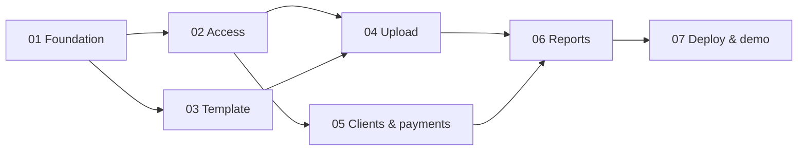

# AGENTS.md

Context for AI coding agents working in this repository. Read this file first, then [docs/architecture.md](docs/architecture.md), then the phase document you were assigned.

## Project in short

A Telegram bot for a sheep-meat trading business:

- **Accountants** download a strict Excel template, fill in one **trip (рейс)**: purchase in Kazakhstan, trip expenses, sales to clients in Tashkent. They upload it; the bot validates, previews and saves it.
- Clients buy on credit and pay later. Accountants record **payments** in the bot.
- Users with **View** permission get reports (client statement, trip summary, debtors) as **PDF or XLSX**.
- One **admin** approves users and grants permissions.

Current goal: an **MVP for a business demo**, happy path only. Bot UI and reports are in **Russian**.

## Documents

| Document | Use it for |
|---|---|
| [docs/analysis-and-plan.md](docs/analysis-and-plan.md) | Business flow, decisions (D1–D13), MVP scope, open assumptions |
| [docs/architecture.md](docs/architecture.md) | **Binding contracts**: layout, layering, config, enums, DB schema, calculations, template spec, bot and report conventions |
| [docs/phases/](docs/phases/) | One self-contained brief per phase |

## Phases

| # | Phase | Depends on | Can run in parallel with | Status |
|---|---|---|---|---|
| 01 | [Foundation](docs/phases/phase-01-foundation.md) | — | — | Done |
| 02 | [Access control and bot shell](docs/phases/phase-02-access-control.md) | 01 | 03 | Done |
| 03 | [Template and demo data](docs/phases/phase-03-template-and-demo-data.md) | 01 | 02, 05 | Not started |
| 04 | [Trip upload](docs/phases/phase-04-trip-upload.md) | 01, 02, 03 | 05 | Not started |
| 05 | [Clients and payments](docs/phases/phase-05-clients-and-payments.md) | 01, 02 | 03, 04 | Not started |
| 06 | [Reports](docs/phases/phase-06-reports.md) | 04, 05 | — | Not started |
| 07 | [Deployment and demo prep](docs/phases/phase-07-deployment-and-demo.md) | 01–06 | — | Not started |



## Working rules

1. **Stay in scope.** Build only what your phase document lists. Items marked "after MVP" are out of scope.
2. **Follow the contracts** in `docs/architecture.md`. If you must change one, update that file in the same change and mention it in the handoff notes below.
3. **Happy path first.** Handle the obvious user mistakes listed in your phase; don't chase rare edge cases.
4. **No automated tests for now** (project decision for the MVP). Verify manually using the "Done when" checklist of your phase.
5. **Language:** user-facing text in Russian; code, identifiers, comments, docs in English.
6. **Code style:** Python 3.12, type hints, `async` for DB and bot code, `Decimal` for kg and money calculations, ruff format + check clean. Keep comments short and only where the code can't speak for itself.
7. **Privacy:** never commit secrets, `storage/`, real sample files, or real client names/phones. Real samples live outside the repo (parent folder) and are reference only.
8. **Don't add dependencies** beyond the stack in `docs/architecture.md` without noting why in the handoff.

## Commands

```bash
python3.12 -m venv .venv && source .venv/bin/activate
pip install -e ".[dev]"
cp .env.example .env            # set BOT_TOKEN and ADMIN_TELEGRAM_ID
python -m sheepbot              # run the bot (long polling)
ruff format . && ruff check .   # format + lint
docker compose up -d --build    # run in Docker
```

## Glossary

| Term | Meaning |
|---|---|
| Рейс / reys / trip | One truck: purchase in Kazakhstan → sale in Tashkent. Unique by number. |
| Фура | Truck |
| Кун / день | Sales day of a trip (1, 2, 3 …) |
| Совлик, Кучкор, Кузи, Эчки | Ewe, ram, lamb, goat (carcasses) |
| Скидка | Weight discount. Purchase: kg per batch. Sale: kg per head from the product code, e.g. `SOV (-1KG)` = 1 kg per head |
| Брутто / нетто | Scale weight / weight after discount |
| Збой / субпродукты | By-products: думба, жигар, лахат, чарви, упка |
| Выписка (hisobot) | Client statement: shipments, payments, running balance |
| Долг / баланс | Client balance; positive = client owes |
| Бухгалтер | Accountant; user with Upload permission |

## Handoff notes

Each phase appends a short entry here when done: what was built, deviations from the docs, anything the next phase must know. Also update the **Status** column above.

### Phase 01 — Foundation

- Built: project files, full package skeleton (later-phase modules are one-line docstrings), config/logging, enums + catalog + formatting, all MVP tables, idempotent seed, `services/clients.py` helpers, `DbSessionMiddleware`, placeholder `/start`, Docker.
- DB access: use `get_engine()` / `get_sessionmaker()` from `db/session.py` (both cached, created lazily). `seed()` flushes but does not commit; `bot/app.py:prepare_db()` commits.
- `DbSessionMiddleware` is registered as `dp.update.outer_middleware`. Register `AuthMiddleware` the same way **after** it, so it can use `data["session"]`.
- Enums are stored by value via `db/base.py:str_enum()`. Reverse label lookup: `domain/enums.py:enum_from_label(labels, text)` plus per-enum wrappers like `animal_type_from_label()` (trimmed, case-insensitive, `ё`=`е`).
- `domain/catalog.py` also exports `PRODUCT_CODES` and the `ProductDef` dataclass.
- Models use `import datetime as dt` because columns named `date` would shadow the `date` type in annotations. Relationships use default lazy loading, so use `selectinload` in async code.
- Deviations: UZS columns are `BigInteger` (still whole so'm; same as INTEGER in SQLite, but no int32 overflow on other DBs). Dependency is `SQLAlchemy[asyncio]` because the async engine needs `greenlet`. `Client.name` also collapses inner whitespace. `bot/texts.py` holds `START_PLACEHOLDER`. The Dockerfile installs the `tzdata` OS package for `zoneinfo`. Added `.dockerignore`.
- Not verified here: live polling and `/start` with a real token; `docker compose up` persistence.

### Phase 02 — Access control and bot shell

- Built: `services/users.py`, `AuthMiddleware`, `HasPermission`, `texts.py` (every `BTN_*` and the `COMMANDS` list), `keyboards.py` (`main_menu`, `cancel_keyboard`, `MENU_ITEMS`, `find_menu_item`), `/start`, `/menu`, `/cancel`, the access request card, `/users`, the fallback router, the global error handler and `set_my_commands`.
- **Adding a feature router:** insert it into `ROUTERS` **between** `common.router` (first) and `common.fallback_router` (last). Because `common.router` comes first, `/start`, `/menu`, `/cancel` and "Отмена" work in any FSM state.
- **Gating a feature:** put `router.message.filter(HasPermission(Perm.X))` and `router.callback_query.filter(...)` on the router, as in `handlers/users.py`. If the filter fails, the update reaches the fallback. The fallback replies "Нет доступа" for known buttons/commands the user may not use, "Функция в разработке" for permitted ones without a handler, and "Не понял" otherwise.
- Handlers receive `session: AsyncSession` and `user: BotUser | None` from the middlewares. `users.is_allowed(user)` means the user has at least one permission.
- Messages use HTML parse mode, so escape user-provided text with `html.escape`.
- Unhandled exceptions: `common.on_error` logs them and replies with `texts.ERROR_GENERIC`. The DB session has already been rolled back by then.
- Deviations: `Perm` is defined in `domain/enums.py` (services need it) and re-exported from `bot/filters.py`. `AuthMiddleware` refreshes the stored `full_name`/`username` from Telegram, so the seeded admin name gets replaced. When the admin turns on a permission in `/users` for a pending user, that user is activated and notified. Unknown users who send anything other than `/start` get "Отправьте /start…". `/users` lists every user except the admin.
- Verified offline by feeding fake updates through the dispatcher: request → grant/reject, permission-gated menus, `/users` toggles, block/unblock, fallback replies. Not yet verified with live Telegram accounts.
