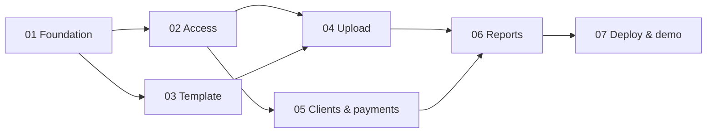

# AGENTS.md

Context for AI coding agents working in this repository. Read this file first, then [docs/architecture.md](docs/architecture.md), then the phase document you were assigned. For phases 08-15, also read the [Mini App roadmap](docs/mini-app-plan.md) and [target architecture](docs/mini-app-architecture.md).

## Project in short

A Telegram bot for a sheep-meat trading business:

- **Accountants** download a strict Excel template, fill in one **trip (рейс)**: purchase in Kazakhstan, trip expenses, sales to clients in Tashkent. They upload it; the bot validates, previews and saves it.
- Clients buy on credit and pay later. Accountants record **payments** in the bot.
- Users with **View** permission get reports (client statement, trip summary, debtors) as **PDF or XLSX**.
- One **admin** approves users and grants permissions.

Current goal: an **MVP for a business demo**, happy path only. Bot UI and reports are in **Russian**.

Next requested delivery track: a Telegram Mini App in this repository plus PostgreSQL, planned in phases 08-15 and sized for a small team (about 10-30 users). Phases 08 (PostgreSQL + Alembic), 09 (API + Telegram auth), 10 (Mini App shell), 11 (clients and payments) and 12 (reports and users) are done; 13-15 are not implemented yet. Keep existing bot workflows working and distinguish current contracts from planned changes.

## Documents

| Document | Use it for |
|---|---|
| [docs/analysis-and-plan.md](docs/analysis-and-plan.md) | Business flow, decisions (D1–D13), MVP scope, open assumptions |
| [docs/architecture.md](docs/architecture.md) | **Binding contracts**: layout, layering, config, enums, DB schema, calculations, template spec, bot and report conventions |
| [docs/mini-app-plan.md](docs/mini-app-plan.md) | Next-track decisions, what is deliberately not built, phases, risks |
| [docs/mini-app-architecture.md](docs/mini-app-architecture.md) | Target contracts for PostgreSQL, API/auth, frontend, trip entry and operations |
| [docs/phases/](docs/phases/) | One self-contained brief per phase |

## Phases

| # | Phase | Depends on | Can run in parallel with | Status |
|---|---|---|---|---|
| 01 | [Foundation](docs/phases/phase-01-foundation.md) | — | — | Done |
| 02 | [Access control and bot shell](docs/phases/phase-02-access-control.md) | 01 | 03 | Done |
| 03 | [Template and demo data](docs/phases/phase-03-template-and-demo-data.md) | 01 | 02, 05 | Done |
| 04 | [Trip upload](docs/phases/phase-04-trip-upload.md) | 01, 02, 03 | 05 | Done |
| 05 | [Clients and payments](docs/phases/phase-05-clients-and-payments.md) | 01, 02 | 03, 04 | Done |
| 06 | [Reports](docs/phases/phase-06-reports.md) | 04, 05 | — | Done |
| 07 | [Deployment and demo prep](docs/phases/phase-07-deployment-and-demo.md) | 01–06 | — | Not started |
| 08 | [PostgreSQL and Alembic](docs/phases/phase-08-postgresql.md) | 01-06 | - | Done |
| 09 | [API and Telegram authentication](docs/phases/phase-09-api-and-auth.md) | 08 | - | Done |
| 10 | [Mini App shell and client list](docs/phases/phase-10-mini-app-shell.md) | 09 | - | Done |
| 11 | [Mini App clients and payments](docs/phases/phase-11-mini-app-clients-payments.md) | 10 | - | Done |
| 12 | [Reports and users](docs/phases/phase-12-mini-app-reports-users.md) | 11 | - | Done |
| 13 | [Trip entry form](docs/phases/phase-13-trip-workspace.md) | 12 | - | Not started |
| 14 | [Trip editing and Excel in the Mini App](docs/phases/phase-14-trip-publishing-excel.md) | 13 | - | Not started |
| 15 | [Server deployment](docs/phases/phase-15-mini-app-rollout.md) | 14 | - | Deferred |

Phase 07 is retained as a legacy bot-only option; its relevant work is carried into 08, 10 and 15 for the new track. It is not a prerequisite for Phase 08. The diagram below records the original MVP sequence; the new dependency graph and milestone gates are in the Mini App roadmap.



## Working rules

1. **Stay in scope.** Build only what your phase document lists. Items marked "after MVP" remain out of scope unless explicitly included in the assigned phase 08-15 brief.
2. **Follow the contracts** in `docs/architecture.md` and the target contracts for the assigned new phase. Update the current architecture when a contract is implemented and mention it in the handoff notes below; do not describe unimplemented plans as current behavior.
3. **Happy path first.** For phases 08-15, also run the manual checks listed in the phase brief, including the permission checks. Do not add durability or concurrency machinery the [roadmap](docs/mini-app-plan.md) lists as deliberately not built.
4. **No automated tests for now** (project decision for the MVP). Verify manually using the "Done when" checklist of your phase.
5. **Language:** user-facing text in Russian; code, identifiers, comments, docs in English.
6. **Code style:** Python 3.12, type hints, `async` for DB and bot code, `Decimal` for kg and money calculations, ruff format + check clean. Keep comments short and only where the code can't speak for itself.
7. **Privacy:** never commit secrets, `storage/`, real sample files, or real client names/phones. Real samples live outside the repo (parent folder) and are reference only.
8. **Don't add dependencies** beyond the current or assigned-phase target stack without noting why in the handoff. The new plan does not authorize installing future-phase dependencies early.
9. **Track delivery honestly.** After a new phase is verified, update its brief/status, the Mini App roadmap, this index and the relevant current contracts. Preserve the no-automated-tests rule unless the owner explicitly approves changing it.

## Commands

```bash
python3.12 -m venv .venv && source .venv/bin/activate
pip install -e ".[dev]"
cp .env.example .env            # set BOT_TOKEN, ADMIN_TELEGRAM_ID, POSTGRES_PASSWORD
docker compose up -d postgres   # local PostgreSQL on 127.0.0.1:5432
alembic upgrade head            # schema
python -m sheepbot              # run the bot (long polling)
python -m sheepbot.api          # run the API on 127.0.0.1:8000 (docs: /api/docs)
cd web && npm ci && npm run dev # Mini App dev server (see README for the dev-auth API)
npm run lint && npm run typecheck && npm run build   # in web/
python scripts/load_demo.py     # demo data into an empty DB (--reset to wipe business data)
ruff format . && ruff check .   # format + lint
docker compose up -d --build    # run in Docker (postgres -> migrate -> bot)
```

## Glossary

| Term | Meaning |
|---|---|
| Рейс / reys / trip | One truck: purchase in Kazakhstan → sale in Tashkent. Unique by number. |
| Фура | Truck |
| Кун / день | Sales day of a trip (1, 2, 3 …) |
| Совлик, Кучкор, Кузи, Эчки | Ewe, ram, lamb, goat (carcasses) |
| Скидка | Weight discount. Purchase: kg per batch. Sale: kg per head from the product code, e.g. `SOV (-1KG)` = 1 kg per head |
| Брутто / нетто | Scale weight / weight after discount |
| Збой / субпродукты | By-products: думба, жигар, лахат, чарви, упка |
| Выписка (hisobot) | Client statement: shipments, payments, running balance |
| Долг / баланс | Client balance; positive = client owes |
| Бухгалтер | Accountant; user with Upload permission |

## Handoff notes

Each phase appends a short entry here when done: what was built, deviations from the docs, anything the next phase must know. Also update the **Status** column above.

### Phase 01 — Foundation

- Built: project files, full package skeleton (later-phase modules are one-line docstrings), config/logging, enums + catalog + formatting, all MVP tables, idempotent seed, `services/clients.py` helpers, `DbSessionMiddleware`, placeholder `/start`, Docker.
- DB access: use `get_engine()` / `get_sessionmaker()` from `db/session.py` (both cached, created lazily). `seed()` flushes but does not commit; `bot/app.py:prepare_db()` commits.
- `DbSessionMiddleware` is registered as `dp.update.outer_middleware`. Register `AuthMiddleware` the same way **after** it, so it can use `data["session"]`.
- Enums are stored by value via `db/base.py:str_enum()`. Reverse label lookup: `domain/enums.py:enum_from_label(labels, text)` plus per-enum wrappers like `animal_type_from_label()` (trimmed, case-insensitive, `ё`=`е`).
- `domain/catalog.py` also exports `PRODUCT_CODES` and the `ProductDef` dataclass.
- Models use `import datetime as dt` because columns named `date` would shadow the `date` type in annotations. Relationships use default lazy loading, so use `selectinload` in async code.
- Deviations: UZS columns are `BigInteger` (still whole so'm; same as INTEGER in SQLite, but no int32 overflow on other DBs). Dependency is `SQLAlchemy[asyncio]` because the async engine needs `greenlet`. `Client.name` also collapses inner whitespace. `bot/texts.py` holds `START_PLACEHOLDER`. The Dockerfile installs the `tzdata` OS package for `zoneinfo`. Added `.dockerignore`.
- Not verified here: live polling and `/start` with a real token; `docker compose up` persistence.

### Phase 02 — Access control and bot shell

- Built: `services/users.py`, `AuthMiddleware`, `HasPermission`, `texts.py` (every `BTN_*` and the `COMMANDS` list), `keyboards.py` (`main_menu`, `cancel_keyboard`, `MENU_ITEMS`, `find_menu_item`), `/start`, `/menu`, `/cancel`, the access request card, `/users`, the fallback router, the global error handler and `set_my_commands`.
- **Adding a feature router:** insert it into `ROUTERS` **between** `common.router` (first) and `common.fallback_router` (last). Because `common.router` comes first, `/start`, `/menu`, `/cancel` and "Отмена" work in any FSM state.
- **Gating a feature:** put `router.message.filter(HasPermission(Perm.X))` and `router.callback_query.filter(...)` on the router, as in `handlers/users.py`. If the filter fails, the update reaches the fallback. The fallback replies "Нет доступа" for known buttons/commands the user may not use, "Функция в разработке" for permitted ones without a handler, and "Не понял" otherwise.
- Handlers receive `session: AsyncSession` and `user: BotUser | None` from the middlewares. `users.is_allowed(user)` means the user has at least one permission.
- Messages use HTML parse mode, so escape user-provided text with `html.escape`.
- Unhandled exceptions: `common.on_error` logs them and replies with `texts.ERROR_GENERIC`. The DB session has already been rolled back by then.
- Deviations: `Perm` is defined in `domain/enums.py` (services need it) and re-exported from `bot/filters.py`. `AuthMiddleware` refreshes the stored `full_name`/`username` from Telegram, so the seeded admin name gets replaced. When the admin turns on a permission in `/users` for a pending user, that user is activated and notified. Unknown users who send anything other than `/start` get "Отправьте /start…". `/users` lists every user except the admin.
- Verified offline by feeding fake updates through the dispatcher: request → grant/reject, permission-gated menus, `/users` toggles, block/unblock, fallback replies. Not yet verified with live Telegram accounts.

### Phase 03 — Template and demo data

- Built: `excel/template_spec.py`, the new `excel/template_builder.py`, `scripts/build_template.py`, `scripts/build_demo_files.py`, `assets/templates/trip_template_v1.xlsx`, `assets/demo/demo_trip_101.xlsx` and `demo_trip_102.xlsx`, and `/template` plus the "Шаблон" button (Upload permission).
- **Contract changes** (architecture sections 2 and 8 are updated):
  - New module `excel/template_builder.py`. `build_template(trip, rows)` returns the workbook as `.xlsx` bytes; with no data it returns the blank template.
  - `ColumnSpec` gained `gt` / `ge` (numeric lower bounds) and `width`.
  - `header` is stored without `*`; `display_header` adds it for required columns.
- **For the parser (Phase 04):**
  - Use `DATA_SHEETS` / `TABLE_SHEETS`, `SheetSpec.column(key)` and `normalize_header()`.
  - The `Рейс` sheet is key/value: rows 2–7 follow the order of `TRIP_SHEET.columns`, values are in column B, and row 1 is `Поле | Значение`.
  - `Продажи.heads` is `required=False` in the spec; the parser must require it for animal products.
  - Column keys: purchases `date, animal_type, heads, gross_kg, discount_kg, price_kzt, note`; expenses `item, qty, unit_price, currency, note`; sales `day, date, client, product, heads, gross_kg, price_thousand_uzs, note`.
- The bot builds the template in memory (cached), so the Docker image doesn't need `assets/`.
- `Справочник` layout: `A1` = version; columns B/C/D hold the Тип / Валюта / Товар lists (header in row 1, values from row 2). Dropdowns cover data rows 2–1000.
- In the demo files, some expenses leave `Кол-во` empty, which tests the "defaults to 1" rule.
- Demo numbers from the generator, computed with the section 7 rounding rules. Phase 04's preview should match them.

  | File | Закуп rows | Heads | Gross kg | Net kg | Продажи lines | Clients | Sold heads | Cost UZS | Revenue UZS | Profit |
  |---|---|---|---|---|---|---|---|---|---|---|
  | `demo_trip_101.xlsx` | 10 | 606 | 20 750.9 | 19 252.7 | 51 | 13 | 606 | 1 868 413 480 | 1 990 946 550 | 122 533 070 (6.6%) |
  | `demo_trip_102.xlsx` | 9 | 602 | 20 724.9 | 19 247.9 | 56 | 13 | 602 | 1 866 720 696 | 2 026 045 700 | 159 325 004 (8.5%) |

  Trips 101 and 102 share 11 of the 15 fictional clients.
- Not verified here: opening the files in Excel or LibreOffice (LibreOffice isn't installed on this machine).

### Phase 04 — Trip upload

- Built: `domain/calculations.py`, `excel/parser.py`, `services/trips.py`, and `handlers/upload.py` (the "Загрузить рейс" prompt, `.xlsx` documents, Сохранить/Отмена with callback prefix `upl`).
- **Calculations:**
  - `trip_totals(purchase_lines, expense_uzs_values, sale_lines) -> TripTotals`. Inputs are the plain `PurchaseLine` / `SaleLine` dataclasses, so Phase 06 can build them from DB rows. A `SaleLine` needs `client_key` (from `normalize_client_name`) and `client_name`.
  - `TripTotals` holds `purchases` / `sales` groups plus by-type, by-day, by-product and by-client groups. It has properties `revenue_uzs`, `cost_uzs`, `profit_uzs`, `margin_pct`, and methods `cost_per_kg(type)` and `avg_sale_price(type)`.
  - The rounding helpers live in the same module.
- **Services:**
  - `trips.compute_trip(parsed, products)` gives per-row computed values plus totals. Preview and save both use it, so their numbers always match.
  - `save_trip` deletes an existing trip with the same number (children go via DB `ON DELETE CASCADE`), creates missing clients, inserts all rows, and marks the upload `saved`.
- **Uploads:**
  - Files are stored as `storage/uploads/<sha256>.xlsx`; identical files are stored once. Every upload gets its own `upload` row.
  - Only the uploader or the admin can press Save/Cancel on a pending upload. A stale button replies "Действие устарело".
  - Parsing runs in a worker thread (`asyncio.to_thread`).
- **Parser:**
  - Sheet names and headers are compared with `normalize_header`. Product codes and choice values are trimmed and case-insensitive (`ё`=`е`).
  - Numbers accept `,` or `.` and spaces. Integers must be whole. Errors are capped at 50, and `ParseResult.too_many_errors` flags the cut. Each sheet allows at most 5,000 rows.
  - If a sheet has a wrong header, its rows are skipped to avoid cascading errors.
- **Additions to the docs:**
  - `formatting.fmt_percent()` and `formatting.plural(n, forms)` (Russian plural forms).
  - The architecture doc now allows Russian validation messages in `excel/parser.py`.
  - The fallback answers "Нет доступа" to documents from users without Upload permission.
- Verified offline (fake updates through the dispatcher):
  - Both demo files preview and save, and the preview totals equal the Phase 03 table.
  - A re-upload shows "ЗАМЕНИТ" and the row counts stay at 10/6/51.
  - Clients go to 13, then to 15 after trip 102, with no duplicates.
  - A broken file is reported with sheet, row and column. `.pdf`, a file larger than 10 MB, a non-Excel `.xlsx`, and a View-only user all get a clear refusal.

### Phase 05 — Clients and payments

- Built: `services/balances.py`, the extended `services/clients.py`, `services/payments.py`, `bot/client_picker.py`, `handlers/payments.py` (`/pay`, `/payments`) and `handlers/clients.py` (`/clients`). FSM groups `ClientPickerStates`, `PaymentStates` and `ClientStates` are in `bot/states.py`.
- **Balances:**
  - `client_balance(session, client_id, as_of=None) -> int`.
  - `all_balances(session)` returns `ClientBalance` rows, ordered by name.
  - `balances_for(session, ids) -> dict` and `get_client_balance(session, id)`.
  - `ClientBalance.balance` is a property (`shipped − paid`). Deleted payments are excluded.
- **Client picker** (Phase 06 will reuse it):
  ```python
  from sheepbot.bot import client_picker


  async def on_picked(callback, state, session, user, client) -> None:
      # FSM is still in ClientPickerStates.query: set your next state or clear it.
      # Do NOT call callback.answer(); the picker does that.
      ...


  client_picker.register("report_statement", on_picked)  # once, at module level
  await client_picker.start(message, state, "report_statement")  # optional keyboard=...
  ```
  - The picker edits the matches message to "Клиент: X" before calling your handler.
  - Its router (`client_picker.router`) only requires that the user has some permission (`IsAllowed`), so View-only users can use it from reports.
  - Callback factory `ClientCb` (prefix `cli`) is shared by the picker and the `/clients` screens.
- **Dialog conventions** (new in `bot/filters.py`):
  - Use `DialogText` for free-text steps. It excludes commands and menu-button texts, so those always reach their own handlers.
  - Every menu-button or command entry handler calls `state.clear()`. The fallback also clears the state on menu buttons.
  - Dialogs show `cancel_keyboard()` and restore `main_menu(user)` at the end.
- `payments.format_balance(b)` / `balance_value(b)` format debt and overpayment ("Переплата"). `/clients` imports them; reports can too.
- Router order is common → users → template → upload → payments → clients → client_picker → fallback. Add the reports router before `client_picker.router`.
- `/payments` shows one list message with "Удалить N" buttons (4 per row) instead of one message per payment. The list isn't refreshed after a deletion; a second press on a deleted entry says "Действие устарело".
- Verified offline (fake updates):
  - A payment lowers the balance by exactly its amount, and the card shows before → after (overpayment shows as "переплата …").
  - `abc`, `0`, a future date and a bad date are rejected. `/cancel` and menu buttons leave the dialog.
  - Deleting a payment restores the balance.
  - Clients: find, add (duplicate rejected), rename (duplicate rejected), list paging, "Внести оплату" from the card.
  - A View-only user is refused `/pay`, `/payments` and `/clients`.

### Phase 06 — Reports

- Built: `reports/data.py`, `reports/xlsx_builder.py`, `reports/pdf_builder.py`, `handlers/reports.py` (`/report`, `/debts`, `/trips`), `ReportStates` in `bot/states.py`, and trip query helpers in `services/trips.py` (`get_trip`, `list_recent_trips`, `trip_totals_from_model`).
- **Fonts:** `DejaVuSans.ttf`, `DejaVuSans-Bold.ttf` and `LICENSE` in `src/sheepbot/reports/fonts/`, registered once in `pdf_builder.register_fonts()`.
- **Report data (`reports/data.py`):**
  - `statement_data(session, client_id, date_from=None, date_to=None) -> StatementData | None`: opening balance before `date_from` (0 for all time), chronological lines (shipments before payments on the same day, then by id), running balance, totals and closing balance.
  - `trip_summary_data(session, trip_id) -> TripSummaryData | None`: uses `trips.trip_totals_from_model(trip)` (`TripTotals`) so revenue, cost, profit, margin and per-type cost/sale prices match the upload preview.
  - `debtors_data(session) -> DebtorsData`: clients with non-zero balance sorted by balance descending, plus totals.
  - `report_filename(title, subject, ext, on_date)` builds `<Title>_<subject>_<YYYY-MM-DD>.<pdf|xlsx>`.
- **Builders:**
  - `build_statement_xlsx`, `build_trip_summary_xlsx` (7 sheets: `Сводка`, `Себестоимость`, `Закуп`, `Расходы`, `Продажи по дням`, `Продажи по товарам`, `Продажи по клиентам`), `build_debtors_xlsx` with frozen headers, numeric/date formatting (`# ##0`, `# ##0.0`, `DD.MM.YYYY`), and `=SUM(...)` total formulas.
  - `build_statement_pdf`, `build_trip_summary_pdf`, `build_debtors_pdf` in landscape A4 with DejaVu Sans, optional `COMPANY_NAME`, generation timestamp + user name, and two-pass `"Стр. N из M"` page numbering.
- **Bot handlers (`handlers/reports.py`, `Perm.VIEW`, callback prefix `rep`):**
  - `/report` / "Отчёты": statement (via `client_picker` → period preset or custom `ДД.ММ.ГГГГ – ДД.ММ.ГГГГ` → PDF/Excel), trip summary (last 10 trips → PDF/Excel), debtors (PDF/Excel).
  - `/debts` / "Должники": top 30 debtors + total in chat with inline "Скачать Excel".
  - `/trips` / "Рейсы": last 10 trips with revenue and profit, each with a button to download its summary as PDF or Excel.
- Verified offline (data, builders, and fake updates through the dispatcher):
  - Shared client statement across trips 101 and 102 matches `/clients` balance; period statement opening + movements = closing.
  - Trip summary totals match upload preview for both demo trips.
  - Debtors total matches sum of positive and negative balances.
  - Upload-only user receives "Нет доступа к этой функции." on `/report`, `/debts`, `/trips`.

### Mini App and PostgreSQL planning (2026-10-31)

- Added a roadmap, target architecture and phase briefs 08-15. Defaults: same repository, PostgreSQL/asyncpg/Alembic first, FastAPI plus React/TypeScript, existing roles and shared Python calculations/services.
- Simplified the same day for a team of about 10-30 users: PostgreSQL starts empty (SQLite data is test-only, no import); API auth validates Telegram `initData` on every request (no session table); no idempotency keys, audit table, version checks, trip drafts or revisions; trips entered in the app replace by number exactly like the bot upload; one server with Compose, Caddy and daily `pg_dump`.
- Existing Phase 07 remains unfinished; its relevant work is allocated to 08, 10 and 15. Phases 08-14 are Not started; Phase 15 is deferred (no server deployment for now). No dependencies, runtime code or data changed during planning.
- The no-automated-tests rule is unchanged.

### Phase 08 — PostgreSQL and Alembic

- Built: `asyncpg` + `alembic` dependencies (`aiosqlite` removed), PostgreSQL default `DATABASE_URL`, `alembic.ini` + `migrations/` with baseline revision `0001` (reviewed autogenerate), `init_db()` now only creates storage folders, Compose services `postgres` (17, volume `postgres_data`, `127.0.0.1:5432`), one-shot `migrate`, `bot`; `POSTGRES_*` in `.env.example`; `scripts/load_demo.py`.
- `Base.metadata` has a naming convention (`db/base.py:NAMING_CONVENTION`); the payment check constraint is now named `amount_positive` (→ `ck_payment_amount_positive`).
- `services/balances.py` casts `SUM(amount_uzs)` to `BigInteger`: PostgreSQL returns numeric/`Decimal` otherwise.
- Compose overrides `DATABASE_URL` to the in-network host `postgres`; `.env`'s `DATABASE_URL` (localhost) is for local runs, scripts and Alembic.
- `load_demo.py` loads trips through `parse_trip_workbook` → `save_trip` as the admin, then fictional payments (full, half, none, 30%, two parts; the first client overpays 500 000). Result: 2 trips, 15 clients, 15 payments, debt 1 724 527 250, credit 500 000. It refuses when trips exist; `--reset` truncates business tables (users/products kept) after typing `yes` or with `--yes`.
- Verified (local Docker, PostgreSQL 17, asyncpg 0.32.0, Alembic 1.20.1): upgrade from empty, `alembic check` clean; demo totals for trips 101/102 equal the Phase 03 table; balances are `int`; statement closing = balance; debtors total = sum of balances; all 6 PDF/XLSX builders; rolled-back probes for duplicate client, payment + soft delete, trip re-save (row counts unchanged, payments kept), pending user; Docker stack start order and bot polling; data kept after `docker compose restart postgres`.
- Not verified here: chat flows by hand in Telegram on the new database. Old SQLite file `storage/app.db` is test data and no longer used.

### Phase 09 — API and Telegram authentication

- Built: `fastapi` + `uvicorn` dependencies; package `src/sheepbot/api/` (`app.py`, `auth.py`, `deps.py`, `schemas.py`, `texts.py`, `routers/health.py`, `routers/me.py`, `__main__.py`); settings `APP_ENV`, `DEV_AUTH_TELEGRAM_ID`, `WEBAPP_AUTH_MAX_AGE_HOURS`, `API_HOST`, `API_PORT`; Compose `api` service (`127.0.0.1:8000`, depends on `migrate`). Contracts are in architecture section 9a.
- **Adding an endpoint:** create a router in `api/routers/`, include it in `create_app()` under `API_PREFIX`. Use `session: Session`, `user: CurrentUser`, or `user: Annotated[BotUser, Depends(require(Perm.UPLOAD))]`. Call services; for writes, `await session.commit()` before returning. Put Russian messages in `api/texts.py`.
- Deviations from the brief: docs are at `/api/docs` and `/api/openapi.json` (not `/docs`) so `/` stays free for the frontend; session dependency is in `api/deps.py`; initData over 16 KiB is rejected.
- The API never creates users: access requests stay in the bot (`/start`). `/me` returns 403 for unknown/pending/blocked users, so the frontend shows a "open the bot" screen for any 403 from `/me`.
- Verified against the Docker `api` service with initData signed locally by the bot token and temporary probe users (deleted afterwards): admin and view-only 200 with correct `permissions`; catalog 9 products; tampered hash/user ID, other bot token, missing user, garbage, wrong scheme, 25 h old, 1 h in future, oversized → 401; unknown/pending/blocked → 403; no header → 401; blocking a user takes effect on the next request; `require(Perm.UPLOAD)` rejects a view-only user (no Upload endpoint exists yet); dev shortcut works only with `APP_ENV=dev` and logs a warning; unknown `/api` path → JSON 404; no initData in logs.
- Not verified: a launch from a real Telegram client (needs the Phase 10 frontend and an HTTPS tunnel).

### Phase 10 — Mini App shell and client list

- Built: `web/` (create-vite react-ts template; React 19, React Router 7, TanStack Query 5, TypeScript 7 strict, Vite 8, oxlint), files `src/{main.tsx, router.tsx, Root.tsx, components.tsx, api.ts, telegram.ts, texts.ts, format.ts, index.css, pages/ClientsPage.tsx, pages/ClientPage.tsx}`; API `GET /clients`, `GET /clients/{id}` (`api/routers/clients.py`, `balances.page_balances` + `BalanceFilter`); SPA serving from `WEB_DIST_DIR`; Dockerfile Node build stage; bot `set_profile` (Russian description/short description, menu button from `MINI_APP_URL`). Contracts: architecture 9a/9b.
- **Adding a screen:** page component in `web/src/pages/`, route in `router.tsx`, nav entry with required permissions in `components.tsx:NAV_ITEMS`, strings in `texts.ts`, API call + type in `api.ts`. Never do money arithmetic in TypeScript; format the API strings.
- Deviations: the template uses oxlint instead of ESLint; API types are hand-written (openapi-typescript not added while the API is small); system font stack instead of a bundled font (Cyrillic renders fine on target platforms); filter chips wrap instead of scrolling.
- The bot now sets its Russian description and short description at every start (changed on the live bot profile). With `MINI_APP_URL` empty it resets the menu button to the default commands button.
- Verified: API filters (all 15 / debt 9 / credit 1 / zero 5 on demo data), paging without overlap, case-insensitive search, `%` treated literally, 404 Russian message, invalid filter/limit → 422; SPA routes return `index.html`, `/api/...` and missing assets return JSON 404, encoded `../` paths never return files. In the browser with the dev-auth API: list at 360/390 px and 1200 px, light and dark, search + filter kept in the URL and restored on back, detail page, deep link back goes to `/clients`, no-match and not-found states; production build in Docker shows only the access screen without Telegram. Python ruff and frontend lint/typecheck/build pass.
- **Real Telegram launch verified** 2026-10-31: `cloudflared` (Homebrew) quick tunnel to `127.0.0.1:8000`, `MINI_APP_URL` set in `.env`, bot recreated; the owner opened the app from the current bot's "Приложение" button and API logs show authenticated requests. The quick-tunnel URL changes on every `cloudflared` restart: update `MINI_APP_URL` and run `docker compose up -d --force-recreate bot`. Clearing `MINI_APP_URL` restores the default menu button.

### Phase 11 — Clients and payments in the Mini App

- Built: API `POST /clients`, `PATCH /clients/{id}`, `GET /clients/{id}/ledger`, `GET|POST /payments`, `DELETE /payments/{id}` (`api/routers/clients.py`, `api/routers/payments.py`); `UploadUser` dependency; `schemas.InputModel` (rejects unknown fields) with client/payment input models; Russian validation messages; services `payments.page_payments`, `clients.set_phone`. Web: `hooks.ts`, `pages/ClientFormPage.tsx`, `pages/PaymentFormPage.tsx` (client picker → form → confirmation with before/after → result with the server balance), `pages/PaymentsPage.tsx` (recent payments, inline delete confirmation), ledger and actions on `ClientPage`, "Добавить клиента", Payments in the bottom nav for Upload users. Contracts: architecture 9a/9b.
- **Double tap:** a disabled button does not stop a fast double tap (both clicks fire before React re-renders) — this created a duplicate payment during testing. Every write button now goes through `useSingleFlight()`. Re-verified: double-tap save → one payment; double-tap delete → one deletion.
- Validation mirrors the bot: name 2–100 chars, payment amount positive whole so'm (max 10^12), no future date, note ≤ 500. Additions: phone limited to digits, spaces and `+ - ( )`, max 32.
- Deviations: no cancellation reason (simplified plan); payment edit = delete + re-enter; the confirmation's "balance after" uses `BigInt` (exact) and the result screen shows the server balance.
- Verified (dev-auth API + browser at 390 px, Docker API with signed initData): create/duplicate (case/space)/rename/rename-to-existing/clear phone; invalid amounts, future date, bad method, long note, unknown client, unknown field; overpayment shown as "Переплата"; two separate equal payments both recorded; delete restores balance once, second delete → 404; ledger all-time closing = balance and period opening + shipped − paid = closing; View-only user: ledger 200, every write and the payment list 403. Test rows were removed afterwards (demo back to 15 clients / 15 payments).
- Not verified here: the new screens inside real Telegram (same build as the verified Phase 10 launch; the owner can click through via the tunnel).

### Phase 12 — Reports and users

- Built: API routers `trips.py`, `reports.py` (debtors + report files + send-to-chat), `users.py`; `reports/files.py` (statement/trip/debtors → `ReportFile`); `api/telegram.py` send-only bot client; `ViewUser`/`AdminUser` dependencies; `services/trips.py` `trip_id_by_number`, `count_trips`, `offset` in `list_recent_trips`; bot `handlers/users.py` now exports `notify_granted`/`notify_closed` (used by bot and API). Web: `pages/{Trips,Trip,Debtors,Reports,Users,More}Page.tsx`, shared `ClientPicker.tsx`, `formatPercent`/`formatRate`/month helpers. Contracts: architecture 9a/9b.
- Permissions: trips and debtors for any permission (Upload users need them for daily work; the bot's `/trips` stays View-only); report files need View; users need admin.
- Verified: trip list/summary equal the Phase 03 table (101: cost 1 868 413 480, revenue 1 990 946 550, 6,6 %; 102: 8,5 %); debtors debt − credit = net; all three reports as PDF and XLSX with correct type, Cyrillic file name and `no-store`; send-to-chat delivered two test files to the admin's chat; bad range/format and missing client/trip handled; user transitions (approve by double tap → one change, toggle, block with confirmation, unblock, reject, admin protected, failed notifications to fake IDs only logged); Docker API matrix with signed initData: Upload-only 403 on report files and users, View-only 403 on users. UI checked at 390 px. Probe users removed.
- Not verified: the browser "Скачать" save dialog (the integrated browser doesn't expose downloads; the request returns 200) and the Phase 11/12 screens inside real Telegram.
