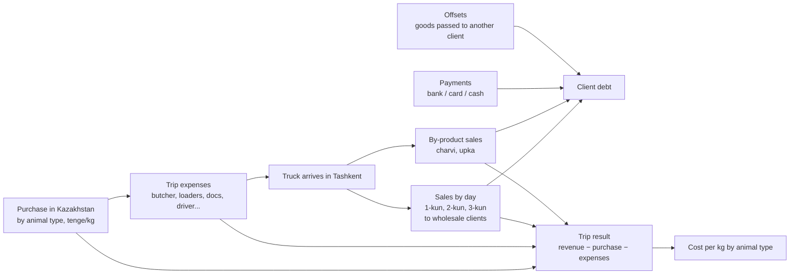
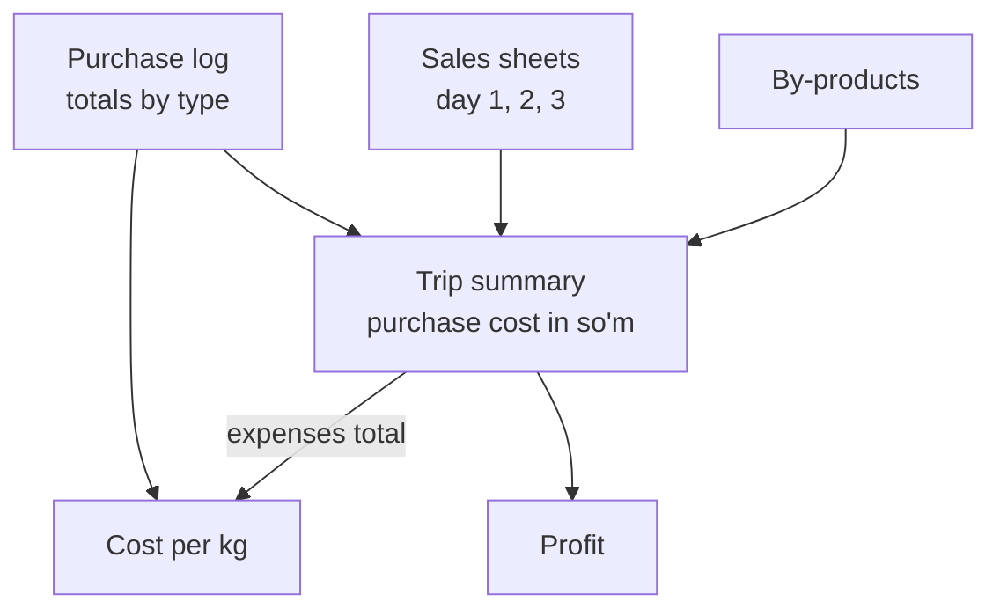
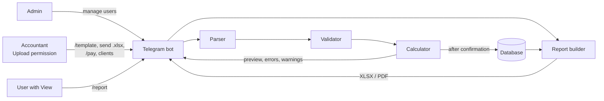
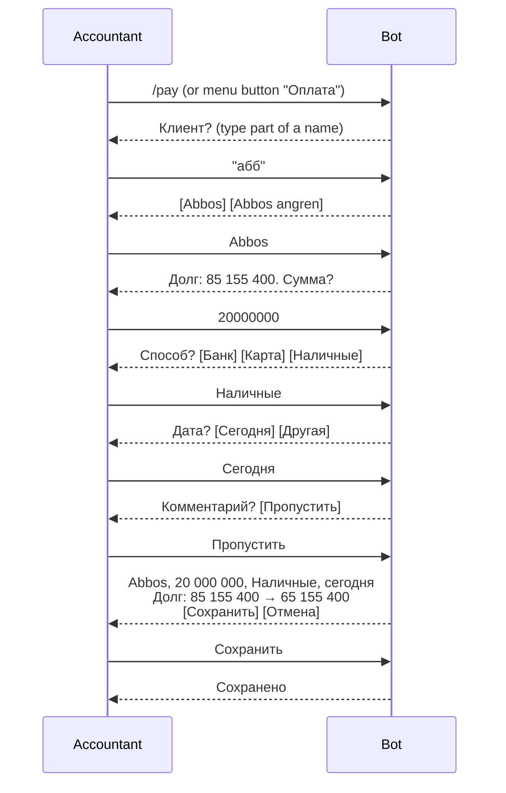
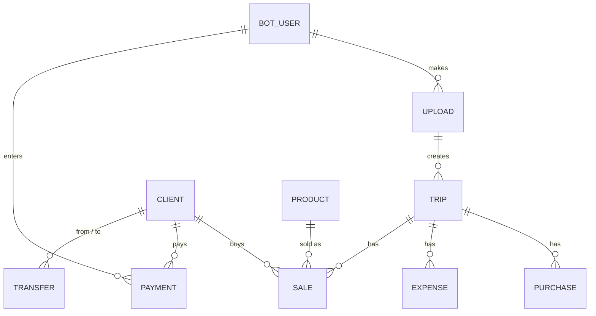

# Sheep Trade Bot — Analysis, Plan and Open Questions

## 1. Goal

Build a Telegram bot that:

1. Accepts a trip workbook (`.xlsx`) filled in **our strict template**.
2. Validates it, calculates all derived values, and stores the data in a database.
3. On request, builds reports (client statement, trip summary, debts, etc.) as **XLSX or PDF** and sends them back through the bot.

Bot messages, templates and reports are in **Russian**. The sample files in this folder (`Qoy_fura_110_res__Nodir.xlsx`, `ChiyalMeat_Салох жиян_130.*`) are **illustrative only**: they show the business flow, not the exact input/output format, and their numbers may be inconsistent.

**First milestone: an MVP for a business demo.** Happy path only; edge cases and extra features come after business feedback (see section 8).

---

## 2. Decisions

| # | Topic | Decision |
|---|---|---|
| D1 | Access | Only approved users. One **admin** (set at deployment) grants and revokes two permissions per user: **Upload** and **View reports**. |
| D2 | Input format | All trips use one **strict template** defined by us. Files that don't match are rejected with clear error messages. |
| D3 | Sample data | Sample workbooks and reports are used only to understand the flow. |
| D4 | Product code | `SOV (-1KG)` = animal type **Sovliq** + **1 kg discount per head**. Net kg = scale kg − heads × discount. |
| D5 | Animal types in scope | Sovliq, Quchqor, Quzi, Echki. **Сон** and **Quzi‑quchqor** are out of scope. |
| D6 | Language | Russian only (bot, templates, reports). |
| D7 | Reports | Our own improved design (see 7.8). ChiyalMeat is only a similar app used for reference; no integration or migration. |
| D8 | Re-upload | Uploading a file with an existing trip number replaces that whole trip. |
| D9 | Source of truth | The database. Excel is only the input format. |
| D10 | Client list | Maintained by **accountants** (users with Upload permission). |
| D11 | View access | **View** sees all clients and trips; no finer access rules. |
| D12 | Delivery | MVP first (happy path), demo to the business, then improve based on feedback. |
| D13 | Payments | Belong to the **client**, not to a trip. Accountants enter them **in the bot** (`/pay`); the trip file has no payments sheet. Bulk upload from a file comes after the MVP. |

---

## 3. Business Flow

One **trip (reys)** = one truck of sheep bought in Kazakhstan and sold in Tashkent.



### 3.1 Purchase (Kazakhstan)
- Animals are bought in batches by type: **Sovliq** (ewe), **Quchqor** (ram), **Quzi** (lamb), **Echki** (goat).
- Each batch: head count → scale weight → discount (kg) → **net kg** → price in **tenge/kg** → amount.
- Today the purchase is also checked against a paper notebook (*daftar*).

### 3.2 Trip expenses
- Butcher (per head), loaders, documents, cart (per head), driver, other people.
- Amounts are in **tenge or USD** and converted to so'm with a manually entered rate.

### 3.3 Sales (Tashkent)
- Sold over several days (trip day 1, 2, 3 …).
- Each line: client, product, head count, scale kg, price (**thousand so'm/kg**).
- The product code carries the per-head discount: `SOV (-1KG)` → Sovliq, 1 kg off per head. **Net kg = scale kg − heads × discount**; amount = net kg × price.
- By-products (charvi, upka, …) are sold by kg, without a per-head discount.

### 3.4 Payments
- Clients usually take meat **on credit** and pay later, in full or in parts, often weeks after the trip. One payment can cover debt from several trips.
- Payments arrive by **bank transfer**, **card**, or **cash**; accountants record each one.
- In the sample they sit in separate sheets with a "from whom" (`Кимдан`) column and are **not linked** to the sale lines.

### 3.5 Trip result
- **Profit** = sales revenue − purchase cost (converted to so'm) − trip expenses.
- **Cost per kg** per animal type: purchase amount + share of expenses (split by each type's share of purchase value) ÷ net kg.

### 3.6 Client statement
- Per client, **across all trips**, chronological ledger:
  - **Shipment** (debit): net kg × price, linked to trip and day.
  - **Payment** (credit): bank / card / cash.
  - **Transfer**: client's goods handed to another client; the debt moves to that client (credit for one, debit for the other).
- **Running balance** after each line; last balance = current debt.

---

## 4. Sample Files: Structure and Lessons

### 4.1 Trip workbook (sample)
One sheet per stage: client directory, purchase log, one sales sheet per day, by-products, bank receipts, cash receipts, trip summary, cost per kg. Summary sheets pull totals from the others with cross-sheet formulas:



### 4.2 Client statement (sample)
Header (company, client, ID, phone, generation time) → ledger lines (date, operation, kg, price, shipment amount, paid, method, comment, balance) → totals and final debt. Same data in PDF and XLSX.

### 4.3 Lessons → rules
| Seen in samples | Rule for our template / system |
|---|---|
| Totals, notes and stray cells inside data areas; layout shifts between files | Fixed sheet names and header row; one plain table per sheet; no totals or notes inside tables |
| Formulas, `#DIV/0!`, numbers stored as text | Input holds **raw facts only**; the bot calculates every derived value; numbers and dates must be real numbers and dates |
| Client name variants (`"Abbos "` vs `"Abbos"`) | Names are trimmed; new names are listed in the upload preview and added to the client list on confirmation |
| "Paid" column in sales **and** separate bank/cash sheets | No "paid" column in sales; every payment is entered once, in the bot, against the client, with method |
| Debt transfers recorded as payments | Separate operation type (after MVP) |
| Tenge and USD in one column; hard-coded rate | Currency column per expense; one rate per currency in the trip header |
| One sales sheet per day | One sales sheet with a "day" column |
| Purchase differs from notebook; sold kg/heads differ from purchased | Validation warnings shown before saving |
| Unused template sheets, stale dates | Versioned template; unknown sheets ignored; dates checked against the trip date |
| Truck numbers repeat | Trip number is the unique key |
| Payment method always empty | Payment method required |
| No product or head count in the statement | Stored per sale and shown in reports |

---

## 5. Input Template v1 (proposal)

### 5.1 General rules
- Users get the template from the bot (`/template`): an `Инструкция` sheet and dropdowns for products and currencies. *(MVP: a static file. Later: generated with a client dropdown and a version marker.)*
- Sheet names and column headers must not be changed.
- Row 1 = headers, data from row 2; no empty rows inside a table; no merged cells.
- Raw values only; formulas are ignored.
- Required fields are marked `*`.

### 5.2 Sheets
| Sheet | Columns | Notes |
|---|---|---|
| `Рейс` | Номер рейса*, Дата отправки*, Дата прибытия, Курс KZT→UZS*, Курс USD→UZS*, Примечание | One record |
| `Закуп` | Дата*, Тип*, Голов*, Вес брутто кг*, Скидка кг*, Цена KZT/кг*, Примечание | Type: Sovliq / Quchqor / Quzi / Echki |
| `Расходы` | Статья*, Кол-во, Цена за ед.*, Валюта* (KZT/USD/UZS), Примечание | Amount = qty × price; qty defaults to 1 |
| `Продажи` | День*, Дата*, Клиент*, Товар*, Голов, Вес брутто кг*, Цена тыс. сум/кг*, Примечание | Heads required for animal products; by-products included here |

Payments are **not** part of the trip file (D13, see 7.5). Transfers between clients come after the MVP, most likely as a bot dialog like payments.

### 5.3 Product catalog (seeded in the database)
| Code | Animal type | Category | Discount, kg/head |
|---|---|---|---|
| `SOV (-1KG)` | Sovliq | Animal | 1.0 |
| `QO'CH (-1KG)` | Quchqor | Animal | 1.0 |
| `QO'Z (-0,5KG)` | Quzi | Animal | 0.5 |
| `ECHKI (-0,5KG)` | Echki | Animal | 0.5 |
| `DUMBA`, `JIGAR`, `LAXAT`, `CHARVI`, `UPKA` | — | By-product | 0 |

The discount in effect at upload time is copied into each sale row, so later catalog changes don't alter past trips.

### 5.4 Validation
| Level | Behaviour | Examples |
|---|---|---|
| **Error** (MVP) | File rejected; bot lists sheet, row, column and reason | missing sheet or column; empty required cell; text in a number/date cell; unknown product |
| **Error** (later) | same | wrong template version; zero or negative kg/price; discount ≥ scale kg; sale date before trip date |
| **Warning** (later) | Shown in the preview; user can still save | sold heads ≠ purchased heads per type; sold net kg > purchased net kg; price far from the usual range |

---

## 6. Calculation Rules
- **Purchase:** net kg = scale kg − discount kg; amount KZT = net kg × price; amount UZS = amount KZT × KZT rate.
- **Expense:** amount = qty × unit price; amount UZS = amount × rate of its currency (UZS = 1).
- **Sale:** net kg = scale kg − heads × discount per head; amount UZS = net kg × price × 1000.
- **Trip profit** = Σ sales − Σ purchases (UZS) − Σ expenses (UZS).
- **Cost per kg** for type *t* = (purchase UZSₜ + expenses UZS × shareₜ) ÷ net kgₜ, where shareₜ = purchase UZSₜ ÷ Σ purchase UZS.
- **Client balance** = Σ shipments − Σ payments − Σ transfers out + Σ transfers in.
- **Storage:** money as whole so'm; KZT/USD as decimals; kg with 1 decimal; rates as decimals.

---

## 7. Proposed Solution

### 7.1 Architecture



### 7.2 Tech stack
| Area | Choice |
|---|---|
| Language | Python 3.12 |
| Bot | aiogram 3 (inline keyboards) |
| Excel input | openpyxl, read-only, values only (formulas ignored) |
| Template | Static `.xlsx` with dropdowns (MVP) |
| Database | SQLite for MVP (PostgreSQL later), SQLAlchemy |
| XLSX output | openpyxl (real numbers + formulas) |
| PDF output | ReportLab with a Cyrillic font (DejaVu) |
| Config | Environment variables (bot token, admin ID, DB URL) |
| Deployment | Docker on a VPS |

### 7.3 Access control
- The admin's Telegram ID is set in configuration; the admin has all rights.
- A new user sends `/start` → the bot sends the admin an access request with buttons **Загрузка / Отчёты / Оба / Отклонить**.
- The admin can change or revoke permissions at any time (`/users`).
- Users without permission get a short refusal.

### 7.4 Upload pipeline

```mermaid
sequenceDiagram
  participant U as User
  participant B as Bot
  participant S as Service
  participant D as Database
  U->>B: .xlsx file
  B->>S: file checks (type, size, template version)
  S->>S: parse → validate → calculate
  alt has errors
    S-->>B: errors (sheet, row, column, reason)
    B-->>U: Файл отклонён + list of errors
  else valid
    S-->>B: preview + warnings
    B-->>U: summary with [Сохранить] [Отмена]
    U->>B: Сохранить
    B->>S: save
    S->>D: one transaction; same trip number replaces the previous version
    B-->>U: Сохранено
  end
```

The preview shows trip number, heads and kg bought/sold, revenue, expenses, profit, and any new client names. The original file is kept.

### 7.5 Payment entry (`/pay`)



- A payment lowers the client's **total** balance; it is not linked to a specific trip or shipment.
- Each payment stores client, amount, method, date, comment, who entered it and when.
- Mistakes: `/payments` lists recent payments with a **Удалить** button; delete and enter again (no editing in the MVP).
- After the MVP: bulk upload of a payments file (e.g. a bank statement) with preview and possible-duplicate check; linking payments to the oldest shipments for debt aging.

### 7.6 Data model (draft)



| Entity | Key fields |
|---|---|
| `bot_user` | telegram_id, name, is_admin, can_upload, can_view, status |
| `client` | id, name, phone, active |
| `product` | code, name, category (animal / by-product), discount_per_head |
| `trip` | number (unique), departure/arrival dates, rate_kzt, rate_usd, upload_id |
| `purchase` | trip, date, animal_type, heads, gross_kg, discount_kg, net_kg, price_kzt, amount_kzt, amount_uzs |
| `expense` | trip, item, qty, unit_price, currency, amount, amount_uzs |
| `sale` | trip, day, date, client, product, heads, gross_kg, discount_per_head, net_kg, price, amount_uzs |
| `payment` | client, date, amount_uzs, method (bank / card / cash), note, entered_by, entered_at |
| `transfer` *(after MVP)* | from_client, to_client, date, kg, price, amount_uzs, note, entered_by |
| `upload` | file_hash, stored file, uploaded_by, uploaded_at, status |

### 7.7 Bot commands (Russian UI)
Telegram command names must be Latin (`a-z`, `0-9`, `_`), so commands are English; their descriptions and all menu buttons are Russian. Users mostly use the reply-keyboard menu.

| Command | Menu button | Who | Flow |
|---|---|---|---|
| `/start`, `/menu` | — | anyone | access request, or main menu |
| `/template` | Шаблон | Upload | receive the blank template |
| send `.xlsx` | Загрузить рейс | Upload | validate → preview → save |
| `/pay` | Оплата | Upload | enter a client payment (7.5) |
| `/payments` | Последние оплаты | Upload | recent payments, delete a wrong one |
| `/clients` | Клиенты | Upload | list / add / rename clients |
| `/report` | Отчёты | View | report type → client or trip → period → PDF/XLSX → file |
| `/debts` | Должники | View | quick list of debtors in chat |
| `/trips` | Рейсы | View | list of trips with key figures |
| `/users` | Пользователи | Admin | manage permissions |
| `/cancel` | Отмена | anyone | leave the current dialog |

### 7.8 Reports
| Report | MVP | Parameters | Content / improvements over the samples |
|---|---|---|---|
| **Выписка по клиенту** | ✅ | client, period | opening balance for the period; product, heads, scale/discount/net kg per shipment; trip number and day instead of a free-text truck note; payment method; subtotals (shipped / paid); closing balance |
| **Итоги рейса** | ✅ | trip | purchase by type, expenses, sales by day / product / client, profit and margin, cost per kg by type |
| **Должники** | ✅ | — | current balance per client |
| Debt aging | later | date | age of debt (e.g. 0–7, 8–30, 30+ days) |
| **Движение денег** | later | period | payments by method and by client |

All reports: Russian, company header, generated by / at, page numbers in PDF, real numbers and formulas in XLSX.

### 7.9 Security and reliability
- Accept only `.xlsx` (no macros), with size and row limits; read-only parsing.
- Secrets only in environment variables.
- After MVP: daily database backup, audit log.

---

## 8. MVP Scope and Delivery Plan

### 8.1 MVP (business demo, happy path)
| In MVP | After feedback |
|---|---|
| Admin + Upload/View permissions, access requests | Audit log, backups, monitoring |
| Static template via `/template` | Generated template with client dropdown and version check |
| Upload: parse → basic errors → preview → save; re-upload replaces the trip | Warnings, cross-checks (heads/kg bought vs sold), stricter rules |
| New clients created from the upload; `/clients` list / add / rename | Merge duplicate clients |
| Payments entered in the bot (`/pay`), delete via `/payments` | Bulk payments file upload, editing, transfers between clients |
| Reports: client statement, trip summary, debtors (PDF + XLSX) | Debt aging, cash flow, scheduled reports |
| SQLite, one Docker container | PostgreSQL, migrations |

### 8.2 Steps to the demo
The build is split into phases, each a self-contained brief for one agent: see [phases/](phases/) and the index in [AGENTS.md](../AGENTS.md). Technical contracts shared by all phases are in [architecture.md](architecture.md).

### 8.3 After the demo
Collect feedback → prioritise → iterate on template, reports and validation.

---

## 9. Open Questions

### 9.1 MVP assumptions (confirm during the demo)
| # | Assumption |
|---|---|
| A1 | Purchase discount is entered as total kg per batch, as in the sample. |
| A2 | Sale prices are in thousand so'm/kg; purchases in KZT; expenses in KZT, USD or UZS. |
| A3 | One exchange rate per currency per trip. |
| A4 | Cost per kg splits expenses by each type's share of purchase value. |
| A5 | Product catalog as in 5.3 (codes, per-head discounts, by-products). |
| A6 | Reports show no company name/logo until the business provides one. |

### 9.2 For after the demo
- Transfers between clients: format and rules.
- Paper-notebook totals in the template for comparison.
- Correction rows (negative values) vs fixing the original row.
- Extra or scheduled reports (e.g. daily debtors list to the admin).
