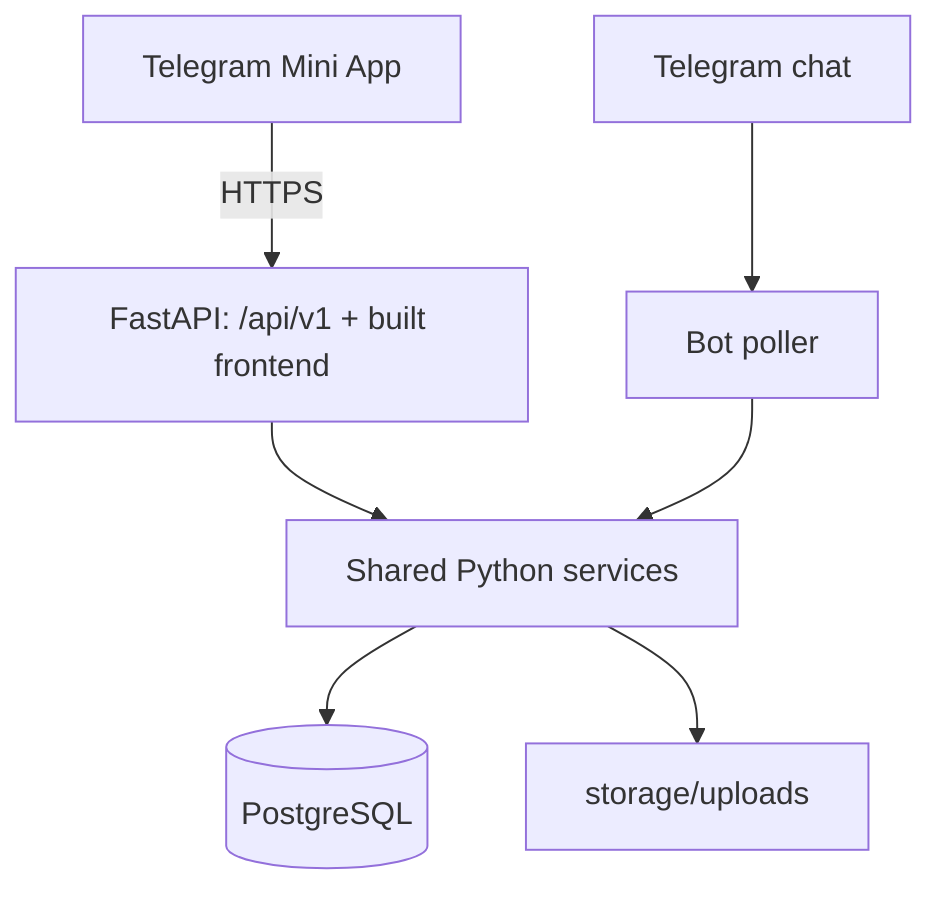

# Mini App Target Architecture

Status: planned contracts for phases 08-15, not a description of deployed code. Simplified for a small team (about 10-30 users) on 2026-10-31; see the roadmap's sizing assumption.

Read the [roadmap](mini-app-plan.md) and the [current architecture](architecture.md) first. Unchanged calculations and bot behavior keep following the current architecture.

## 1. Components

| Component | Choice | Introduced |
|---|---|---|
| Database | PostgreSQL 17, asyncpg | 08 |
| Schema management | Alembic, checked-in revisions | 08 |
| HTTP service | FastAPI, Uvicorn | 09 |
| Web | React, TypeScript (strict), Vite, npm lockfile | 10 |
| Routing/data | React Router, TanStack Query | 10 |
| Telegram bridge | Official `telegram-web-app.js` behind a small typed wrapper | 10 |
| API types | openapi-typescript, optional; hand-written types are fine while the API is small | 10 |
| HTTPS | Caddy (a temporary tunnel during local development) | 15 |

Keep aiogram, SQLAlchemy, openpyxl, ReportLab, pydantic-settings and ruff. Remove aiosqlite once the bot runs on PostgreSQL. Plain CSS and native forms are enough; add a form or UI library only if a phase clearly needs it. No Next.js, Redis, Celery, WebSockets, JWT library or repository layer.

## 2. Layout and Runtime

New paths, created only when a phase needs them:

```text
sheep-calc-mgmt/
  alembic.ini
  migrations/
  src/sheepbot/
    api/
      app.py          # FastAPI app, routers, error handlers (static frontend from Phase 10)
      auth.py         # initData validation, CurrentUser, require(perm)
      deps.py         # per-request session
      schemas.py
      texts.py        # Russian API messages
      routers/
  web/
    src/
  Caddyfile           # Phase 15
```



- The API serves the built frontend at `/` and endpoints at `/api/v1`. API routes are registered before the SPA fallback, so an unknown `/api/...` path returns a JSON 404.
- In development, Vite proxies `/api` to FastAPI.
- One bot process and one API process. Migrations run once before both start (a one-shot `migrate` Compose service, or `alembic upgrade head` by hand); neither process calls `create_all`. The bot keeps its idempotent product/admin seed at startup.

## 3. Authentication

1. The frontend sends the raw `Telegram.WebApp.initData` string on every API request as `Authorization: tma <initData>`.
2. The server validates it with aiogram's `safe_parse_webapp_init_data(bot_token, init_data)`. A missing or invalid signature, a missing user, or an `auth_date` older than `WEBAPP_AUTH_MAX_AGE_HOURS` (default 24) gives 401.
3. Each request loads `bot_user` by Telegram ID. Unknown, pending or blocked users get 403 with a hint to open the bot and press /start; access requests stay in the bot. Permission changes take effect on the next request.
4. Never trust `initDataUnsafe` or a user ID sent in a body or query. Do not store initData in localStorage or URLs, and do not log the Authorization header.
5. Local development only: when `APP_ENV=dev` **and** `DEV_AUTH_TELEGRAM_ID` are set, requests without initData act as that user and startup logs a warning. Never set these on a server.

No session table, logout, token refresh or rate limiting. HTTPS, the signature check, the age limit and the per-request permission lookup are enough at this size.

## 4. Permissions

Same meaning as in the bot. Admin passes every check; the configured admin cannot be blocked or demoted. Checks run on the server through one FastAPI dependency built on the existing permission logic; hiding a button is not authorization.

| Capability | Upload | View | Admin |
|---|---|---|---|
| Client list, balances, ledger | Yes | Yes | Yes |
| Create/edit client | Yes | No | Yes |
| Recent payments, record/cancel payment | Yes | No | Yes |
| Trip list and summaries | Yes | Yes | Yes |
| Create/replace trips, Excel upload | Yes | No | Yes |
| Reports (PDF/XLSX) | Only with View | Yes | Yes |
| Users | No | No | Yes |

The bot's own command gates stay as they are.

## 5. API Contract

### Representation

- IDs and counts: JSON numbers (Telegram IDs fit safely in a JavaScript number).
- Money, kg, prices and rates: strings, e.g. `"1868413480"`, `"19252.7"`. The frontend formats them and never does money arithmetic.
- Dates `YYYY-MM-DD`; timestamps ISO 8601 in UTC. Business "today" uses `TIMEZONE`.
- Trips are addressed by number (`/trips/101`) because replacing a trip may change its internal ID.
- Request bodies reject unknown fields. Clients cannot send creator IDs, totals or other server-computed values.

### Endpoints

All paths are under `/api/v1`.

| Phase | Endpoints |
|---|---|
| 09 | `GET /me`, `GET /catalog` |
| 10 | `GET /clients`, `GET /clients/{id}` |
| 11 | `POST /clients`, `PATCH /clients/{id}`, `GET /clients/{id}/ledger`, `GET /payments`, `POST /payments`, `DELETE /payments/{id}` (soft delete) |
| 12 | `GET /trips`, `GET /trips/{number}`, `GET /debtors`, `GET /reports/{kind}`, `POST /reports/{kind}/send`, `GET /users`, `PATCH /users/{id}` |
| 13 | `POST /trips/preview`, `PUT /trips/{number}` |
| 14 | `GET /trips/{number}/input`, `POST /uploads/parse` |

Lists use `limit` (default 50, max 200) and `offset`, with a stable order and ID tie-breaker.

Errors: `{"detail": "<Russian message>", "fields": {"sales[3].gross_kg": "<message>"}}` (`fields` optional). Status codes: 401 invalid/expired initData, 403 no permission, 404 not found, 409 duplicate (client name, trip number race), 422 invalid input.

## 6. Transactions and Concurrency

- One `AsyncSession` per API request. Write endpoints call `await session.commit()` before returning, so success is only reported after commit. Services keep flushing and never commit.
- The bot keeps its current middleware commit.
- Unique violations (client name, trip number created twice at once) become a 409 with a readable message.
- No version columns: last write wins for client edits, user changes and trip replacement. Acceptable at this size.
- Report data is loaded with the normal session, then rendered in `asyncio.to_thread`, as in the bot.

## 7. Schema Changes

| Phase | Change |
|---|---|
| 08 | Alembic baseline equal to the current models, applied to an empty database |
| 13 | `trip.upload_id` becomes nullable (a trip entered in the form has no upload) |

Other phases add no tables unless their brief says so. Keep enums as plain strings, money as Numeric/BigInteger and timestamps in UTC, as today.

## 8. Trips

- **One input shape.** The form sends the same fields and units as the Excel template, including the sale price in thousand UZS per kg. The server turns it into the existing `ParsedTrip` and validates it with the same `template_spec` rules the parser uses, so Excel and the form cannot disagree.
- **Preview** (`POST /trips/preview`): `compute_trip` totals, row-addressed errors and whether the number already exists ("ЗАМЕНИТ").
- **Save** (`PUT /trips/{number}`): the existing `save_trip` behavior. It replaces a trip with the same number, creates missing clients and never touches payments. The upload is optional.
- **Edit (Phase 14):** load the stored rows back into the input shape, let the user change them, save again. Sale discounts come from the current catalog, as with an Excel re-upload today.
- **Excel in the app (Phase 14):** parse the uploaded file into the input shape and show it in the form before saving.
- The bot's Excel upload keeps working unchanged.

## 9. Frontend

- A plain, dense working UI: Telegram theme colors (light and dark), tabular numerals, a Cyrillic-capable font, no dashboards or decorative charts.
- Bottom navigation on phones, usable from 360 px wide; desktop just gets wider tables.
- Each screen handles loading, empty, error-with-retry and no-access states.
- The query cache lives in memory only and is refetched after writes. Nothing financial is stored in the browser.
- Submit buttons are disabled while a request is pending; success is shown only after the server responds.
- Telegram BackButton follows navigation. MainButton is optional.
- Trip form: header plus Purchases, Expenses and Sales tabs, add/remove rows, and a Review step with server totals. A new sale row keeps the previous day, date and product.
- All UI strings are Russian and kept in one module.

## 10. Reports and Files

- Reuse `reports/data.py` and the existing builders.
- `GET /reports/{kind}` returns the file with a safe `Content-Disposition` and `Cache-Control: no-store`.
- Downloads inside Telegram mobile WebViews are unreliable, so the main action is "Отправить в чат": the bot sends the file to the requesting user's own chat. The recipient always comes from the authenticated user, never from the request.
- No public file URLs and no credentials in URLs.

## 11. Operations and Configuration

New settings: `DATABASE_URL` (`postgresql+asyncpg://...`), `MINI_APP_URL` (optional; enables the launch button), `WEBAPP_AUTH_MAX_AGE_HOURS`, `APP_ENV`, `DEV_AUTH_TELEGRAM_ID` (dev only). The frontend never receives `BOT_TOKEN` or DB credentials.

Compose services: `postgres` (named volume; no public port, loopback-only port in development), `migrate` (one-shot `alembic upgrade head`), `bot`, `api` (serves the built frontend), and Caddy from Phase 15. Bot and API share `storage/uploads`. Restart policy `unless-stopped`; logs through `docker compose logs`.

Backups (Phase 15): a daily `pg_dump` plus a copy of `storage/uploads`, stored off the server, about 14 days kept, restore tried once. Schema changes stay additive, so rolling back means running the previous image tag; data loss means restoring the latest dump.

## 12. External References

Telegram documentation was consulted while planning on 2026-10-31. The remaining links are implementation references; recheck APIs/version requirements during their owning phase.

- [Telegram Mini Apps](https://core.telegram.org/bots/webapps)
- [Telegram initData validation](https://core.telegram.org/bots/webapps#validating-data-received-via-the-mini-app)
- [Telegram menu launch](https://core.telegram.org/bots/webapps#launching-mini-apps-from-the-menu-button)
- [SQLAlchemy async patterns](https://docs.sqlalchemy.org/en/20/orm/extensions/asyncio.html)
- [Alembic tutorial](https://alembic.sqlalchemy.org/en/latest/tutorial.html)
- [PostgreSQL backup and restore](https://www.postgresql.org/docs/17/backup.html)