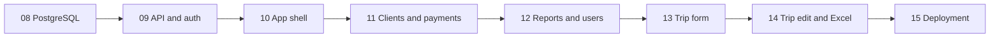

# Telegram Mini App and PostgreSQL Plan

Status: planned, not implemented. Created: 2026-10-31. Simplified for a small team: 2026-10-31.

## 1. Outcome

Make daily accounting comfortable inside Telegram without a spreadsheet or a long chat dialog. Keep the bot as a companion, keep Excel as an optional bulk input, and move the database to PostgreSQL before adding a second writer (the API).

This is the next delivery track after the bot MVP, not a rewrite. The existing [architecture](architecture.md) describes the running application; these documents describe changes to implement one phase at a time.

### Sizing assumption

An internal tool for one business: one admin and roughly 10-30 staff, one server, low write volume. Rare simultaneous edits are acceptable and are resolved by the people involved. Prefer the simplest design that keeps money exact and data access authorized; do not build machinery for scale, high availability or forensic auditing.

### Reading order

1. This roadmap: scope, decisions, phases, risks.
2. [Target architecture](mini-app-architecture.md): database, auth, API, frontend and operations contracts.
3. The relevant phase brief.
4. [AGENTS.md](../AGENTS.md): working rules and status index.

## 2. Decisions

| ID | Decision | Reason |
|---|---|---|
| M01 | One repository and one Python package; add `api/` and `web/`. | Shared models, services and calculations. |
| M02 | PostgreSQL 17, SQLAlchemy async, asyncpg, Alembic. | Bot and API write to one database; schema changes need a history once real data exists. |
| M03 | FastAPI with Pydantic schemas. | Reuses Python services; OpenAPI for the frontend. |
| M04 | React + TypeScript + Vite, client-rendered, mobile-first. | No SEO or server rendering needed. |
| M05 | The API serves the built frontend and `/api/v1` from one HTTPS origin; bot and API are separate processes. | Simple deployment, no CORS. |
| M06 | Launch from the bot menu button or an inline Web App button in private chat. | Provides signed launch data. |
| M07 | Every API request carries Telegram `initData`; the server validates its signature and reads current permissions from the DB. No session table. | Nothing to store or expire beyond Telegram's own signature. |
| M08 | Keep Admin, Upload, View. No new roles. | Preserve current access rules. |
| M09 | Payments belong to clients; record external payments only. | Current accounting model. |
| M10 | Calculations stay on the server with `Decimal`; the API sends money, kg and rates as strings. | No JavaScript rounding. |
| M11 | Clients and payments before trip entry. | Daily value first. |
| M12 | A trip is entered in one form and saved in one go. Saving a trip number that already exists replaces it, exactly like the bot upload today. No drafts, versions or revision history. | Owner decision 2026-10-31; matches current behavior. |
| M13 | Excel and the form use the same validate/preview/save service. | One definition of a valid trip. |
| M14 | Docker Compose on one host, Caddy for TLS, PostgreSQL not exposed publicly, daily `pg_dump`. | Enough for this size. |
| M15 | Russian UI and reports; English code and docs. | Repository convention. |
| M16 | Current SQLite data is test/demo only. PostgreSQL starts empty; no SQLite import. | Owner decision 2026-10-31. |

### Deliberately not built

Idempotency keys and command receipts, an audit-event table, version columns and optimistic locking, server sessions, trip drafts and revisions, advisory locks, snapshot-isolated reports, rate limiting, export limits, a monitoring stack, a staging environment, large device matrices and a SQLite-to-PostgreSQL importer. Add one only if a real problem shows it is needed.

Cheap measures cover the common cases: submit buttons are disabled while a request is pending, payments keep their existing `entered_by`/`deleted_by` fields, unique constraints stop duplicate clients and trip numbers, and the "ЗАМЕНИТ" warning appears before a trip is replaced.

## 3. Product Shape

### First screen

Open the working application, not a landing page. The default is a client/balance list with search and a permission-aware payment action. An accountant should reach a client's balance in two interactions after launch, then record a payment without leaving the client context.

Viewer-only users get a read-only balance list and report navigation. Users awaiting approval see only their own access status and a route back to the bot. Administrators also see pending access requests.

### Navigation

Four primary destinations: Clients, Trips, Payments, More. More contains Reports and, for admins, Users. Hide unavailable destinations rather than leaving dead buttons. On desktop use a compact side navigation and wider tables; on phones use stable bottom navigation and focused row editors.

| Workspace | Main interaction | Important state |
|---|---|---|
| Clients | Search, filter debt/credit/zero, open a client | Balance, chronological ledger |
| Payments | Enter payment from a client; recent entries | Before/after balance, confirmation |
| Trips | Recent trips; purchases/expenses/sales tabs; new/edit form | Server-calculated totals |
| Reports | Choose client/trip/period, view, download or send to own chat | Generation time |
| Users | Approve, block, change Upload/View permissions | Current status; configured admin protected |

### Useful details

- A client screen combines the ledger and the payment action.
- Balances distinguish debt from credit. Overpayments stay allowed and visible.
- The trip form remembers day, date and product for the next sale row; it does not copy weight, heads or money.
- Validation errors point to the exact purchase/expense/sale row.

Do not add gamification, promotional dashboards, decorative charts, AI entry, OCR, or a new accounting vocabulary to the initial release.

## 4. Delivery Phases

Each phase has a brief under `docs/phases/`. Phase numbers continue the original sequence.

| Phase | Deliverable | Depends on | Status |
|---|---|---|---|
| 08 | [PostgreSQL and Alembic](phases/phase-08-postgresql.md) | Existing 01-06 | Done |
| 09 | [API and Telegram authentication](phases/phase-09-api-and-auth.md) | 08 | Done |
| 10 | [Mini App shell and client list](phases/phase-10-mini-app-shell.md) | 09 | Done |
| 11 | [Clients and payments](phases/phase-11-mini-app-clients-payments.md) | 10 | Done |
| 12 | [Reports and users](phases/phase-12-mini-app-reports-users.md) | 11 | Done |
| 13 | [Trip entry form](phases/phase-13-trip-workspace.md) | 12 | Not started |
| 14 | [Trip editing and Excel in the Mini App](phases/phase-14-trip-publishing-excel.md) | 13 | Not started |
| 15 | [Server deployment](phases/phase-15-mini-app-rollout.md) | 14 (or 12 for an early pilot) | Deferred |

### Milestones

- **After 08:** the bot runs on PostgreSQL with Alembic; demo data loads.
- **After 11:** open the app -> find a client -> record a payment -> the bot shows the same balance.
- **After 12 (Release A):** daily clients/payments/reports/users work in the app; trips still come in through the bot's Excel upload. Can be deployed early through Phase 15 if wanted.
- **After 14 (Release B):** trips can be entered and edited without Excel; Excel stays optional.
- **After 15:** running on a server with HTTPS and daily backups.

### Current execution mode: local development only

User decision, 2026-10-31: no server deployment for now. Build phases 08-14 on the development Mac; Phase 15 is deferred.

1. **Phase 08:** PostgreSQL in Docker on the Mac (loopback port only), Alembic, the bot pointed at it through `.env`.
2. **Phase 09:** FastAPI locally against the same database.
3. **Phase 10 onward:** Vite dev server proxying `/api` to FastAPI.
4. **Real Telegram checks:** Telegram needs an HTTPS URL. With the owner's approval, use a temporary tunnel (Cloudflare Tunnel or ngrok) to the local app and a separate development bot. Never run two pollers with the same token.

### What happens to Phase 07?

The original [Phase 07](phases/phase-07-deployment-and-demo.md) is an unfinished bot-only deployment plan, not a dependency of this track. Its demo loader moves into 08, the bot description into 10, and deployment/walkthrough into 15. Do not mark it complete because a new plan exists.

### Execution discipline

Implement one brief at a time; after manual verification update its status/handoff, this roadmap, the AGENTS index and the current architecture. Keep Alembic revisions in one ordered history. Do not implement future phases early.

## 5. Accounting Rules to Keep

1. Client balance = shipped minus non-deleted payments. Positive = debt; negative = credit, shown as such.
2. Saving a trip is one transaction: all of its rows are saved or none.
3. Replacing a trip never touches payments; payments belong to clients.
4. `margin_pct` is profit divided by cost. Label it as return on cost; do not change the formula.
5. Calculations and rounding follow [architecture.md](architecture.md) section 7 for every input path.
6. After Phase 08 there is one database. Bot and API both use it.

## 6. Verification Policy

No automated tests (unchanged project rule). Each phase has a short manual checklist. Run `ruff format . && ruff check .` and, from Phase 10, the frontend lint/typecheck/build. Use fictional data in anything committed.

## 7. Open Questions

| ID | Question | Default |
|---|---|---|
| Q01 | Where will the server run? | Deferred to Phase 15; a small VPS is enough. |
| Q02 | Can accountants see every client's balance? | Yes, as today. View users see all reports. |
| Q03 | Should reports go straight to customers? | No. Download, or send to the requesting staff member's own chat. |
| Q04 | Do we need debt aging, transfers, bank imports or payment collection? | No. Optional phone editing is included in 11. |
| Q05 | Offline entry? | No. The app is online-only; nothing financial is stored in the browser. |

## 8. Main Risks

| Risk | Mitigation |
|---|---|
| Someone fakes a Telegram identity | Validate the `initData` signature on every request; never trust `initDataUnsafe` or a client-supplied user ID. |
| A removed user keeps access | Permissions are read from the DB on every request. |
| A double tap creates two payments | Disable the button while saving; the extra payment is visible in recent payments and can be cancelled. |
| Two people save the same trip at once | Last save wins, as with the bot today; the "ЗАМЕНИТ" warning shows before replacing. |
| Server or disk is lost | Daily `pg_dump` and uploads copied off the server; restore tested once (Phase 15). |
| A report leaks | Files are returned only to an authorized requester or sent to their own chat; no public file URLs. |

## 9. Out of Scope

Multi-company tenancy, customer portal, app-store app, offline writes, live co-editing, bank/payment integrations, debt allocation or aging, transfers, OCR/AI entry, analytics dashboards, and the items under "Deliberately not built" above.

## 10. Next Action

Start [Phase 13](phases/phase-13-trip-workspace.md).